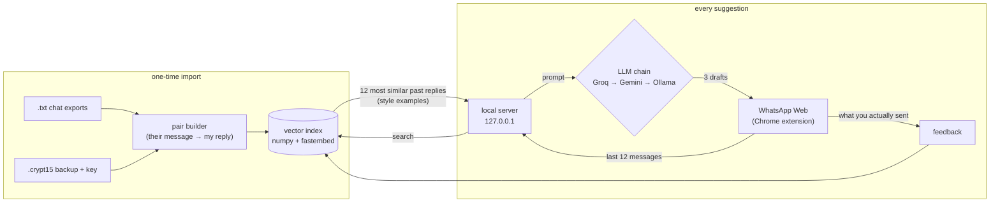

# ✨ Reply Copilot for WhatsApp Web

Reply suggestions that sound like **you**, drawn from your own chat history and running on your own machine.

Open a chat in WhatsApp Web and press **✨** (or `Alt+S`). You get three drafts written in your usual
style: your length, tone, slang and emoji. Click one and it goes into the message box. **Nothing is ever
sent automatically.** When you do send (as-is or edited), that reply becomes a new example, so it keeps
learning your style the more you use it.

> **This repo is a framework.** It ships with no chat data and no API keys. You import your own WhatsApp
> history and write your own `.env`. `python -m copilot doctor` (and the extension popup) tells you
> exactly what is still missing.

<!-- demo: add docs/demo.gif here -->

---

## How it works



This is **retrieval-augmented generation, not fine-tuning.** Your past replies are retrieved and shown to
the model as *style examples* for every request. That means:

- **No training run, no GPU.** Importing thousands of chats takes about a minute on a laptop CPU.
- **It learns instantly.** A reply you send is searchable on the very next suggestion.
- **You can swap models freely.** Your "style" lives in your data, not inside a model's weights.

Design decisions worth knowing:

| Decision | Why |
|---|---|
| Bursts are merged on both sides | People split one thought across several messages. Pairing an answer with only the last fragment files it under the wrong question. |
| Replies more than 24 h later aren't pairs | Past that point it's a new conversation, not an answer. |
| Group chats are skipped | A reply in a group answers several people and makes a misleading example. |
| Retrieved replies are style only | The prompt forbids copying facts from examples, so a past "see you at 7" never becomes today's promise. Missing facts become `[placeholder]`. |
| Provider fallback is the normal path | Free tiers rate-limit. A provider that errors, times out or returns unusable JSON hands over to the next one. If all fail, you still get your own closest past replies. |
| Plain numpy instead of a vector DB | A personal history is at most tens of thousands of pairs, and one matrix multiply answers in milliseconds. |

---

## Setup

Requires Python 3.10+ and Chrome.

```bash
git clone https://github.com/FENGFANCHEN-012/whatsapp-reply-copilot
cd whatsapp-reply-copilot
pip install -r requirements.txt

python -m copilot init      # creates .env with a random SERVER_TOKEN
python -m copilot doctor    # shows what's left to do
```

### ⚠️ Things you must configure yourself

| In `.env` | What it is | Required? |
|---|---|---|
| `MY_NAME` | Your name **exactly** as it appears in your chat exports. It's how your own messages are recognised. | Yes |
| `SERVER_TOKEN` | Shared secret between the extension and the server. Generated by `init`. | Yes |
| `GROQ_API_KEY` | Free at [console.groq.com/keys](https://console.groq.com/keys) | At least one LLM is recommended |
| `GEMINI_API_KEY` | Free at [aistudio.google.com/apikey](https://aistudio.google.com/apikey) | 〃 |
| Ollama | Fully local option: install [ollama.com](https://ollama.com), then `ollama pull llama3.2:3b` | 〃 |
| `EMBED_MODEL` | Default is English. If you mostly chat in another language, use a multilingual model. | Optional |

Without any LLM the app still works: it suggests your own closest past replies, unchanged.

### 1. Import your chats

**Option A: chat exports (simplest, you choose which chats).**
On your phone, open a chat → ⋮ → *More* → *Export chat* → **Without media**. Then run:

```bash
python -m copilot import "WhatsApp Chat with Alex.txt" "WhatsApp Chat with Jordan.txt"
```

**Option B: a full backup (every 1-to-1 chat).**
This needs an end-to-end encrypted backup made with a **64-digit key** (WhatsApp → Settings → Chats →
Chat backup → End-to-end encrypted backup). Copy `msgstore.db.crypt15` off the phone, then run:

```bash
python -m copilot import --backup msgstore.db.crypt15 --key -     # "-" = type the key hidden
```

The decrypted database only ever exists in a temp folder and is deleted right after import. Add
`--append` to combine several imports.

### 2. Build the index, then start the server

```bash
python -m copilot index     # first run downloads a ~70 MB embedding model
python -m copilot serve     # prints any setup still missing
```

### 3. Load the extension

1. Go to `chrome://extensions` and turn on **Developer mode**.
2. Click **Load unpacked** and choose the `extension/` folder.
3. Click the ✨ Reply Copilot icon, paste your `SERVER_TOKEN`, then **Save & check setup**. The popup
   shows the same checklist as `doctor`.
4. Open [web.whatsapp.com](https://web.whatsapp.com), open a chat and press ✨ or `Alt+S`.

### Try it without your own data

```bash
python -m copilot import --me Sam examples/*.txt
python -m copilot index
```

The `examples/` chats are entirely fictional.

---

## Measuring it

```bash
python -m copilot eval --no-llm        # retrieval baseline, no API calls
python -m copilot eval --limit 50      # plus LLM drafts (rate-limit friendly, 2 s apart)
```

The newest 10% of your pairs are held out. The split is by time, not random, because a random split
would put the same conversation on both sides. Each held-out message is then scored by how close the
suggestions come to what you really sent (embedding cosine similarity):

- **`retrieval@1`**: your single closest past reply, used verbatim.
- **`retrieval@k`**: the best of the k retrieved replies. This is the ceiling a perfect re-ranker could reach.
- **`llm_best_of_3`**: the best of the three generated drafts.

Similarity is only a proxy, so `--show N` prints real cases to read as well.

---

## Privacy & security

- **Your chats stay on your machine.** `data/`, `.env`, backups and keys are all git-ignored.
- **What leaves your machine:** each suggestion request sends the last 12 messages of the open chat,
  plus about 12 of your past replies, to whichever LLM provider answers. Use Ollama only if nothing
  should leave your computer.
- **Contacts are never stored.** Contact names and numbers are replaced with a hash before anything is saved.
- **The server is locked down.** It binds to `127.0.0.1` only (`serve` refuses any other host) and
  rejects any request without `X-Copilot-Token`, because every web page you open can reach localhost.
- **The extension only drafts.** It never presses send.

## Project layout

```
copilot/
  config.py        .env loading + the setup checklist (doctor, server startup, /health)
  pairs.py         message stream → (their message → my reply) pairs
  importers/       txt_export.py (Android + iOS formats), msgstore.py (.crypt15 / msgstore.db)
  index.py         embeddings + cosine search (numpy)
  llm.py           Groq / Gemini / Ollama with fallback
  suggest.py       prompt building + parsing + retrieval-only fallback
  server.py        FastAPI: /health /suggest /feedback
  evaluate.py      time-split offline evaluation
extension/         Chrome MV3: content script, background worker, popup
examples/          fictional chats for demos and tests
tests/             pytest
```

```bash
python -m pytest -q
```

## Limitations

- **WhatsApp Web changes its markup without warning.** All DOM selectors live in `SEL` at the top of
  `extension/content.js`.
- **1-to-1 chats only.** Group chats aren't imported and aren't a target.
- **Text only.** Photos, voice notes and stickers are skipped.

## License

MIT
